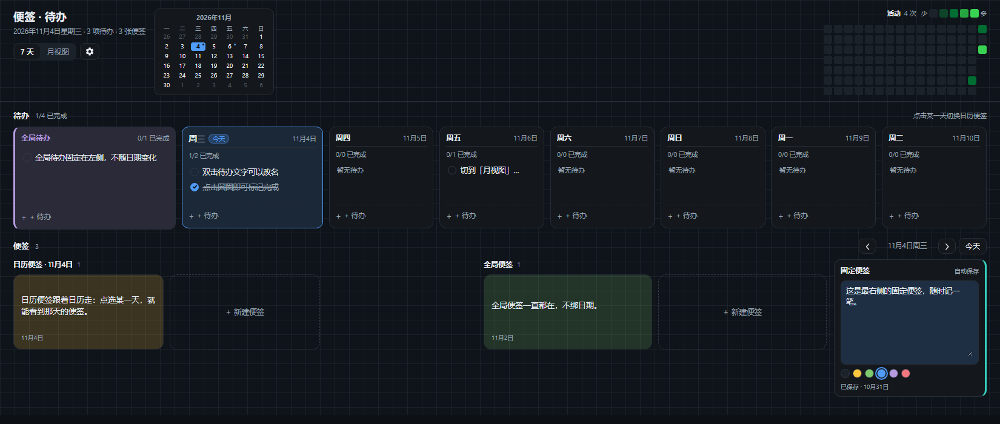
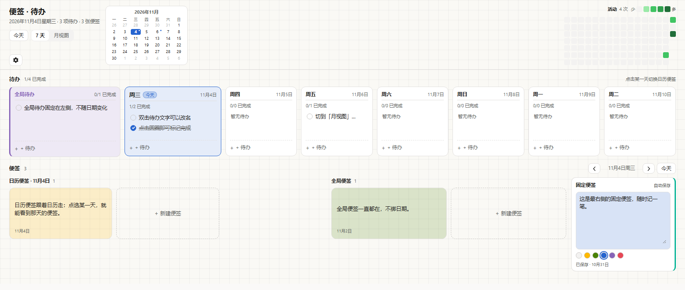

# Notes & Todos · dsh-keep-notes

[](https://github.com/wiills/dsh-keep-notes/actions/workflows/ci.yml)

[简体中文](README.md) | **English**

Keep-style notes, calendar-based todos and a GitHub-style activity heatmap, rendered as a standalone DSH sidebar page. The same board is exposed to the agent through Host tools and can optionally sync across devices through a shared folder.

**Languages**: eight UI languages (中文 · English · 日本語 · Español · Français · Deutsch · Русский · Português) that follow the DSH language setting and switch live.

**Install**: open the DSH **Plugins** install dialog and paste `git+https://github.com/wiills/dsh-keep-notes.git#v1.3.1`, then refresh the page.





## Features

- **Calendar-based todos**: a 7-day view by default, with today's column widened and highlighted; expand to the full month and collapse back with one click.
- **Global todos**: pinned to the far left and independent of the selected date.
- **Two kinds of notes**: calendar notes follow the selected date, global notes stay visible, and a fixed-note rail on the far right is always available for quick captures.
- **Activity heatmap**: GitHub-style green scale, 16 weeks × 7 days, with a 0–4 legend.
- **Mini month calendar**: shows the month, today and days with todos; click a day to jump there.
- **Appearance settings**: background auto / black / white (black and white are fixed palettes that ignore the system theme), per-section background images for the header, todos and notes, and adjustable overlay strength.
- **Theme and colors**: follows the DSH dark/light theme; notes and todos share yellow, green, blue, purple and red from the Microsoft To Do palette.
- **Eight UI languages**: Chinese, English, Japanese, Spanish, French, German, Russian and Brazilian Portuguese follow the DSH language setting and switch live; other DSH languages fall back to English.
- **Shared-folder sync**: click **Choose folder…** in settings and use the system folder picker to select a folder already synced by OneDrive, Dropbox or Syncthing. Todos and notes merge across DSH instances without a plugin cloud service; background images stay local.
- **Agent integration**: agents can use the `keep_notes_*` tools to list, add, edit, complete and remove notes and todos; changes appear in the open panel.

## Languages

The panel covers all eight languages DSH ships. Pick one in **Settings → General → Language** and the panel switches immediately, with no reload:

| Language | Code |
| --- | --- |
| Chinese | `zh` |
| English | `en` |
| Japanese | `ja` |
| Spanish | `es` |
| French | `fr` |
| German | `de` |
| Russian | `ru` |
| Portuguese (Brazil) | `pt` |

- Every label in the panel, the dates and weekdays, the sidebar entry, and the plugin page title and description switch with it.
- Without an explicit DSH language choice, the panel follows the browser/system language and falls back to English.
- Languages outside the DSH catalog (including third-party language packs) currently fall back to English.
- Only UI copy is translated; text already written into todos and notes stays as it is.

## Installation

### Install directly from GitHub (recommended)

Open the **Plugins** install dialog in DSH, paste the following line and press Enter:

```
git+https://github.com/wiills/dsh-keep-notes.git#v1.3.1
```

Then refresh the page. `#v1.3.1` is a tag; use `#main` to follow the main branch, or `#<commit SHA>` to pin a specific commit.

### Install from the plugin market (optional)

1. Enable the experimental plugin market bundle `@deepseek-ai/dsh-experimental-plugin-market-bundle` in DSH.
2. Open **Plugins → Discover → Index sources** and add:

   ```
   https://wiills.github.io/dsh-keep-notes/index.json
   ```

   If GitHub Pages is not enabled yet, the raw address also works (icons included):

   ```
   https://raw.githubusercontent.com/wiills/dsh-keep-notes/main/docs/index.json
   ```

3. Search for "notes" or "便签" and install the plugin, then refresh the page.

Market versions also point at GitHub commits; npm is not required. An npm source will be added once npm publishing is available.

## Upgrading

DSH does not update installed plugins automatically. Installation pins a tag or commit, so upgrading is an explicit reinstall:

1. In **Plugins**, reinstall the latest version, for example `git+https://github.com/wiills/dsh-keep-notes.git#v1.3.1`; use the plugin page's update/reinstall action when available.
2. Alternatively, refresh the plugin market index and install the latest version there.
3. Refresh the page after installation.

Upgrading from `#v1.3.0` to 1.3.1 only replaces the plugin code and does not remove data: todos and notes live in `~/.dsh/keep-notes/board.json`, while the panel cache and background images live in browser `localStorage`, outside the plugin package. If you use a `link:` local checkout for development, reload the plugin instead of reinstalling.

## Usage

- **7-day / month view**: switch from the toolbar; return to today from the mini calendar or the **Today** control beside the notes.
- **Add a todo**: click **+ Todo** at the bottom of any day column.
- **Complete a todo**: click the circle on the left; click the text to rename it. While editing, the dots below the input also change that todo's color (use **Default** to remove the color).
- **Todo colors**: a colored todo gets a matching tint and left edge inside its day column; the dots only affect that todo, not the column.
- **Add a note**: click **+ New note**; the dots at the bottom of the note change its color.
- **Fixed note**: the rail on the far right saves as you type.
- **Settings**: the gear is to the right of the 7-day / month switch. Change the background (auto / black / white), replace section background images or adjust overlay strength. The shared-folder sync controls sit at the bottom of the same panel; click outside the panel or press Esc to close it.
- **Cross-device sync**: open Settings → **Shared-folder sync** and click **Choose folder…**. Select an existing folder in the system picker, such as a `dsh-keep-notes` folder inside OneDrive. There is nothing to type; choose each device's own local folder. The plugin writes one `dsh-keep-notes.board.json` file and the cloud-storage client transports it. Once enabled, the plugin checks and merges every 5 seconds; reopen Settings to see the status or change the folder.

## Data and privacy

- The Host stores the shared board at `DSH_HOME/keep-notes/board.json` (usually `~/.dsh/keep-notes/board.json`). The panel also keeps an offline `localStorage` cache (`dsh.keep-notes.board.v1`, `dsh.keep-notes.appearance.v1`, `dsh.keep-notes.images.v1`) plus the pending-operation queue `dsh.keep-notes.sync.v1`.
- The panel reads and writes the Host through the same-origin `/dsh-keep-notes/*` API. The API requires an authenticated DSH Web session and returns 401 for unauthenticated requests. The plugin makes no external network requests and collects no telemetry.
- On first connection, if the Host board is empty, the panel uploads the existing `localStorage` data. If the Host already has data (for example because an agent wrote first), the Host wins.
- **Shared-folder sync** is optional. When enabled, the Host writes todos and notes to `dsh-keep-notes.board.json` in the chosen folder; other devices read the same file and merge by each item's `updatedAt` and deletion tombstones. Background images are never synced. The file is visible to the selected cloud-storage client or Syncthing, so do not put the sync folder in an untrusted shared location.
- Background images are still compressed locally and stored only in `localStorage`; they are never uploaded to the Host or returned by agent tools.
- Text and images have size limits, and the panel warns when storage is full. When the Host is unavailable, the panel keeps using its local cache and retries the queue after recovery. If the shared folder is not writable or its JSON is corrupt, Settings shows a sync error instead of silently overwriting the shared file.

### Shared-folder sync limitations

- It relies on the system's OneDrive / Dropbox / iCloud / Syncthing client. The plugin does not open connections or store cloud credentials.
- Each device selects its own local folder path. The cloud client copies the file between devices, usually with a delay of seconds to minutes.
- If two devices edit the same item at the same time, the newer modification time wins. Deletions use tombstones so an offline device cannot bring deleted items back. If the cloud client creates a conflict copy, that copy must be handled manually.
- Only todos, notes and the fixed note sync. Appearance, background images and panel settings stay on each device.

## Agent tools

After installation, agents can call:

| Tool | Purpose |
|---|---|
| `keep_notes_list` | List all todos and notes, including ids |
| `keep_notes_add_todo` | Add a todo with an optional date, color or global scope |
| `keep_notes_update_todo` | Rename, recolor, complete or reopen a todo |
| `keep_notes_add_note` | Add a note with an optional date and color |
| `keep_notes_update_note` | Change a note's text or color |
| `keep_notes_remove` | Remove a todo or note |

The tools and the panel share the same Host storage. The panel polls every 4 seconds and also fetches immediately when it regains focus.

### Chat examples

You do not need tool names or JSON. Just ask naturally; the agent chooses the tools and the panel updates within a few seconds.

```text
You: Add a todo due tomorrow: pay rent, red.
Agent: Added "pay rent" for tomorrow in red.

You: Add a note for today: design review at 3pm, green.
Agent: Added the note for today in green.

You: Mark "pay rent" as done.
Agent: Marked "pay rent" as done.
```

More things you can say:

| Say this | What happens |
|---|---|
| Add a global todo: tidy the README | Adds a todo without a date |
| What is still open today? | Lists today's unfinished todos |
| Rename "standup" to "project standup" and make it purple | Updates the todo text and color |
| Make the "design review" note blue | Updates the note color |
| Delete the note whose text is "test" | Finds it and removes it; if several match, the agent lists them first |

Dates such as "today", "tomorrow" or "Friday" are resolved against the current date. If the item is ambiguous, the agent uses `keep_notes_list` to find its id first.

## Compatibility

- DSH `^0.2.1-rc.5` (see `engines.dsh` in `package.json`).
- Web UI; note tints use `color-mix()`, so Edge / Chrome 111+ is required.

## Source layout

DSH can load only one file for the browser half, so [`client.js`](client.js) is a single-file bundle generated from [`src/`](src); do not edit it directly. The Host half is [`index.js`](index.js), [`host-store.js`](host-store.js), [`host-sync.js`](host-sync.js) and [`host-tools.js`](host-tools.js). The sources are split by responsibility:

- Base: `constants.js`, `dictionaries.js`, `dates.js`, `helpers.js`
- Data: `store-seed.js`, `store-sanitize.js`, `store-appearance.js`, `store-create.js`, `sync.js`
- UI: `icons.js`, `todos.js`, `month-grid.js`, `mini-month.js`, `heatmap.js`, `notes.js`, `settings.js`, `panel.js`
- Styles and registration: `styles.js`, `plugin.js`

Run `npm run build` after changing `src/`; `npm run check` verifies that `client.js` is in sync with the sources.

## Development

```bash
npm run build          # generate client.js from src/
npm run check          # syntax checks + generated-file consistency
npm test               # Node test runner (test/board.test.mjs, test/host.test.mjs, test/sync.test.mjs, test/folder-sync.test.mjs)
npm pack --dry-run     # inspect the published file list
npm run validate:index # validate docs/index.json (requires npm install first)
```

For local preview, install this repository as a bundle through `plugin_manager`'s `install_bundle`, or install it with the GitHub URL above.

## Releasing a new version

1. Change the code, run `npm version <x.y.z> --no-git-tag-version`, update CHANGELOG and commit.
2. Create and push the tag: `git tag -a vX.Y.Z -m "dsh-keep-notes X.Y.Z"`, then `git push origin vX.Y.Z`.
3. Add a new entry at the top of `versions[]` in `docs/index.json`; set `publishTimestamp` to the release time (Unix seconds) and point `source` at that version's commit:
   `{"type":"git","url":"https://github.com/wiills/dsh-keep-notes","commit":"<commit SHA>"}`.
4. Run `npm run validate:index`, commit and `git push`.
5. When npm publishing is available, run `npm publish` and change that version's `source` to `{"type":"npm"}`.

## License

MIT © 2026 wiills
