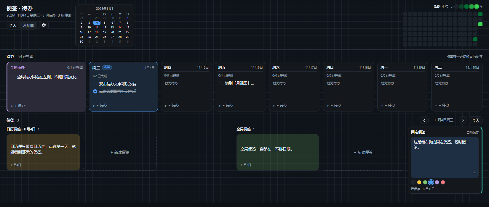
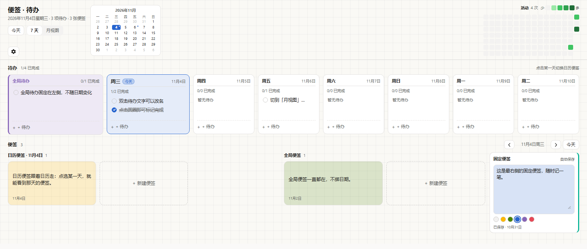

# 便签与待办 · dsh-keep-notes

[](https://github.com/wiills/dsh-keep-notes/actions/workflows/ci.yml)

Keep 风格的便签、按日历排布的待办清单，以及 GitHub 风格的活动热力图。整个功能独立占据 DSH 左侧栏的一个页面；同一份数据也通过 Host 工具开放给 agent 读写，并可选通过共享文件夹在多台设备间同步。

**安装**：DSH → Plugins → 安装对话框，粘贴 `git+https://github.com/wiills/dsh-keep-notes.git#v1.3.0`，装好后刷新页面。





## 功能

- **按日历排布的待办**：默认展示 7 天，今天列自动加宽高亮；可一键展开整月视图，再缩回 7 天。
- **全局待办**：固定在最左侧，不随选中日期变化。
- **两类便签**：日历便签跟随选中日期，全局便签常驻；最右侧还有一栏固定便签，随手记一笔。
- **活动热力图**：GitHub 同款绿色梯度，16 周 × 7 天，带 0–4 图例。
- **顶部迷你月历**：显示整月、今天与有待办的日期，点一下跳到那天。
- **外观设置**：背景可选自动 / 黑 / 白（黑、白固定配色，不跟随系统主题）；标题栏、待办区、便签区可分别设置背景图，遮罩强度可调。
- **主题与配色**：跟随 DSH 深色/浅色主题；便签和待办提供黄、绿、蓝、紫、红五色（Microsoft To Do 色板）。
- **中英文界面**：跟随 DSH 语言切换。
- **共享文件夹同步**：在设置里点「选择文件夹…」，用系统文件夹选择器选一个已被 OneDrive、Dropbox 或 Syncthing 同步的目录，多台 DSH 的待办和便签会自动合并；不需要插件自己的云服务。背景图片仍只在本机。
- **Agent 接入**：agent 可以用 `keep_notes_*` 工具查询、新增、编辑、勾选和删除便签/待办；改动会同步到打开的面板。

## 安装

### 用 GitHub 地址直接安装（推荐）

在 DSH 的 **Plugins** 页面打开安装对话框，粘贴下面这行，回车：

```
git+https://github.com/wiills/dsh-keep-notes.git#v1.3.0
```

装好后刷新页面即可。`#v1.3.0` 是标签；换成 `#main` 跟随主线，或换成 `#<提交 SHA>` 固定到某次提交。

### 从插件市场安装（可选）

1. 在 DSH 中启用实验性插件市场组合包 `@deepseek-ai/dsh-experimental-plugin-market-bundle`；
2. 打开 **Plugins → Discover → Index sources**，添加索引地址：

   ```
   https://wiills.github.io/dsh-keep-notes/index.json
   ```

   Pages 还没启用时，也可以先用 raw 地址（图标同样可用）：

   ```
   https://raw.githubusercontent.com/wiills/dsh-keep-notes/main/docs/index.json
   ```

3. 搜索「便签」或「notes」，安装后刷新页面。

索引里的版本同样指向 GitHub 上的提交，不依赖 npm；npm 可访问后会再补 npm 源。

## 使用

- **7 天 / 月视图**：标题栏工具行切换；回到今天点迷你月历里的今天，或便签区右侧的「今天」。
- **新建待办**：点任意日期列底部的「+ 待办」。
- **完成待办**：点左侧圆圈；点击文字可以改名，编辑时输入框下方的圆点还能换颜色（与便签同一套色板，选「默认」恢复无色）。
- **待办颜色**：带颜色的待办在日期列里显示同色底纹和左侧色条；圆点只影响这一条待办，不影响整列。
- **新建便签**：点「+ 新建便签」；便签底部圆点切换颜色。
- **固定便签**：最右栏，输入即自动保存。
- **设置**：齿轮在「7 天 / 月视图」右侧，可切换背景（自动 / 黑 / 白）、换背景图、调遮罩强度；同一面板底部的「共享文件夹同步」可以点击「选择文件夹…」打开系统选择器。点击空白处或按 Esc 关闭。
- **跨设备同步**：打开设置 →「共享文件夹同步」，点「选择文件夹…」，在系统弹出的文件夹选择器里选一个已经存在的目录，例如 OneDrive 下的 `dsh-keep-notes`。不需要手填路径；每台设备都选自己的同步目录。插件只写一个 `dsh-keep-notes.board.json` 文件，网盘客户端负责传输。启用后每 5 秒检查并合并一次，也可以重新打开设置查看状态或更换文件夹。

## 数据与隐私

- Host 以 `DSH_HOME/keep-notes/board.json`（通常是 `~/.dsh/keep-notes/board.json`）为共享数据源；面板同时保留一份 `localStorage` 离线缓存（`dsh.keep-notes.board.v1`、`dsh.keep-notes.appearance.v1`、`dsh.keep-notes.images.v1`），底部还有一个待同步操作队列 `dsh.keep-notes.sync.v1`。
- 面板通过同源的 `/dsh-keep-notes/*` 本地接口读写 Host；接口要求已登录的 DSH Web 会话，未认证请求返回 401。没有外部网络请求，不收集遥测。
- 首次连接时，如果 Host 板为空，会把 `localStorage` 里的现有数据上传；如果 Host 已有数据（例如 agent 先写入），以 Host 为准。
- **共享文件夹同步**是可选功能：启用后 Host 会把待办和便签写入用户指定目录里的 `dsh-keep-notes.board.json`，其他设备读取同一个文件并按条目的 `updatedAt` / 删除墓碑合并；不会同步背景图。该文件对所选网盘或 Syncthing 可见，请不要把同步目录放在不可信的共享位置。
- 背景图仍只在本机压缩并写入 `localStorage`，不会上传到 Host，也不会出现在 agent 工具结果里。
- 图片与文字都有大小上限，存储不足时面板会提示；Host 不可用时面板继续使用本地缓存，恢复后自动重试队列。共享文件夹不可写或 JSON 损坏时，设置里会显示同步错误，不会静默覆盖共享文件。

### 共享文件夹同步的限制

- 依赖系统的 OneDrive / Dropbox / iCloud / Syncthing 客户端，插件本身不建立连接，也不保存网盘凭据。
- 每台设备单独填写本机路径；同一个共享目录里的文件由网盘复制，通常有几秒到几分钟延迟。
- 两个设备同时改同一条内容时，按修改时间较新的版本合并；删除使用墓碑，避免离线设备把已删条目带回来。极端情况下网盘自己生成“冲突副本”时，需要手动处理该副本。
- 只同步待办、便签和固定便签；外观、背景图、面板设置仍留在各设备。

## Agent 工具

安装后 agent 可以直接使用以下工具：

| 工具 | 用途 |
|---|---|
| `keep_notes_list` | 读取全部待办和便签（含 id） |
| `keep_notes_add_todo` | 新增待办，可指定日期、颜色或设为全局 |
| `keep_notes_update_todo` | 改名、改颜色或勾选/取消完成 |
| `keep_notes_add_note` | 新增便签，可指定日期和颜色 |
| `keep_notes_update_note` | 修改便签文字或颜色 |
| `keep_notes_remove` | 删除待办或便签 |

工具和面板共用同一个 Host 存储；面板每 4 秒轮询一次，也可以切换焦点时立即拉取。

## 兼容性

- DSH `^0.2.1-rc.5`（见 `package.json` 的 `engines.dsh`）。
- Web 端；便签底色依赖 `color-mix()`，需要 Edge / Chrome 111+。

## 源码结构

DSH 的浏览器半边只能加载一个文件，因此 [`client.js`](client.js) 是由 [`src/`](src) 生成的单文件 bundle，不直接手改。Host 半边是 [`index.js`](index.js)、[`host-store.js`](host-store.js)、[`host-sync.js`](host-sync.js) 和 [`host-tools.js`](host-tools.js)。源码按职责拆分：

- 基础：`constants.js`、`dictionaries.js`、`dates.js`、`helpers.js`
- 数据：`store-seed.js`、`store-sanitize.js`、`store-appearance.js`、`store-create.js`、`sync.js`
- 界面：`icons.js`、`todos.js`、`month-grid.js`、`mini-month.js`、`heatmap.js`、`notes.js`、`settings.js`、`panel.js`
- 样式与注册：`styles.js`、`plugin.js`

改完 `src/` 后运行 `npm run build`；`npm run check` 会检查 `client.js` 是否与源码同步。

## 开发

```bash
npm run build          # 从 src/ 生成 client.js
npm run check          # 语法检查 + 生成物一致性
npm test               # Node 原生测试（test/board.test.mjs、test/host.test.mjs、test/sync.test.mjs、test/folder-sync.test.mjs）
npm pack --dry-run     # 查看发布内容
npm run validate:index # 校验 docs/index.json（需先 npm install）
```

本地预览：把仓库目录作为 bundle 安装（`plugin_manager` 的 `install_bundle`），或直接用上面的 GitHub 地址安装。

## 发布新版本

1. 改代码，`npm version <x.y.z> --no-git-tag-version`，更新 CHANGELOG，提交；
2. 打标签并推送：`git tag -a vX.Y.Z -m "dsh-keep-notes X.Y.Z"`，再 `git push origin vX.Y.Z`；
3. 在 `docs/index.json` 的 `versions[]` 顶部加一条新版本，`publishTimestamp` 用发布时间（Unix 秒），`source` 指向该版本的提交：
   `{"type":"git","url":"https://github.com/wiills/dsh-keep-notes","commit":"<提交 SHA>"}`；
4. `npm run validate:index`，提交并 `git push`；
5. npm 可访问时再 `npm publish`，并把该版本的 `source` 改成 `{"type":"npm"}`。

## License

MIT © 2026 wiills

---

## English

Keep-style notes, calendar-based todos and a GitHub-style activity heatmap, rendered as a standalone DSH sidebar page. The same board is exposed to the agent through Host tools and can optionally sync across devices through a shared folder.

- Todos laid out per calendar day: a 7-day view by default, expandable to a full month; today's column is wider and highlighted.
- A global todo column pinned to the left, independent of the selected date.
- Calendar notes follow the selected day, global notes stay put, and a fixed note rail sits on the far right.
- Background mode auto / black / white (black and white ignore the app theme), plus per-section background images.
- GitHub-style 16 × 7 activity heatmap and a mini month calendar.
- Follows the DSH dark/light theme, with an optional fixed black or white background; five note and todo colors from the Microsoft To Do palette; zh/en UI.
- Optional shared-folder sync: click **Choose folder…** in the panel settings and use the system folder picker to select a folder already replicated by OneDrive, Dropbox or Syncthing; todos and notes merge across devices without a plugin cloud service. Background images stay local.
- Agent tools (`keep_notes_*`) can list, add, edit, complete and remove items; panel changes appear in the same board.

Install directly with `git+https://github.com/wiills/dsh-keep-notes.git#v1.3.0` in the Plugins install dialog, or add the index `https://wiills.github.io/dsh-keep-notes/index.json` under **Plugins → Discover → Index sources**. npm publishing is pending.

The Host keeps the shared board at `DSH_HOME/keep-notes/board.json` (usually `~/.dsh/keep-notes/board.json`). The panel keeps a localStorage cache and syncs through the same-origin `/dsh-keep-notes/*` API, which requires an authenticated DSH Web session; unauthenticated requests get 401. No external network requests or telemetry. Images stay in localStorage and are never sent to the Host or returned by agent tools. With shared-folder sync enabled, the Host writes todos and notes (not images) to `dsh-keep-notes.board.json` inside the folder the user chooses; that file is visible to the selected sync provider.
